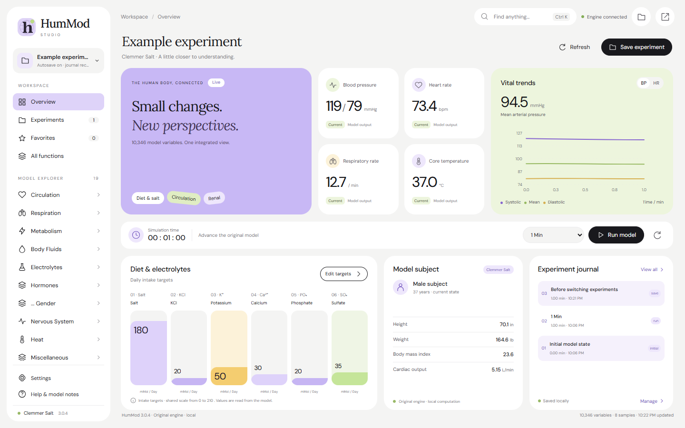

# HumMod UI Beautification

给 HumMod 换一个更清晰、简洁的界面，方便查看参数、运行仿真和整理实验。计算仍由原版 HumMod 完成。

目前支持 **Windows 10/11 64 位**和 **HumMod Clemmer Salt 3.0.4**。

## 安装

1. 准备好课堂使用的 HumMod Clemmer Salt 3.0.4 完整文件夹。
2. 在 [Releases](https://github.com/Aprde/HumMod-UI-Beautification/releases/latest) 下载 `windows-x64.zip` 结尾的安装包，全部解压。
3. 双击 **HumMod Studio.exe**。首次打开时，选择包含 `HumMod.EXE` 的原版文件夹，点击 **Detect & configure**。

无需安装 Node.js 或其他开发工具。若提示缺少 WebView2，请安装 [Microsoft Edge WebView2 Runtime](https://developer.microsoft.com/microsoft-edge/webview2/)。

## 使用

- **New experiment**：填写实验名称，选择保存文件夹。
- **Run model**：选择运行时长，开始仿真；每次运行自动保存一条记录。
- **Experiments**：查看记录、下载 SOL 结果，或打开其他实验。
- **Save experiment / Ctrl+S**：手动保存。下次启动默认打开上次实验。
- **Settings → Save & quit**：保存并退出。仅关闭窗口会保留后台实验。

实验保存在你选择的文件夹中，备份时复制整个文件夹即可。重新打开较长的实验可能需要等待。部分特殊图形和设置仍从原版窗口打开。

**已有旧会话、中途停止或在原版窗口修改过的实验，请保留引擎运行以继续仿真；关闭引擎后仍可查看、导出已保存的结果。**

## 源码与适配

界面和桥接代码采用 [MIT 许可](LICENSE)。本项目不包含 HumMod 内核和模型文件，也不是 HumMod 官方版本。原版软件仍遵循其自身许可。

其他版本或内核尚未适配，需要修改接口并验证计算结果。构建、实验恢复机制和适配说明见 [开发说明](docs/DEVELOPMENT.md)。

